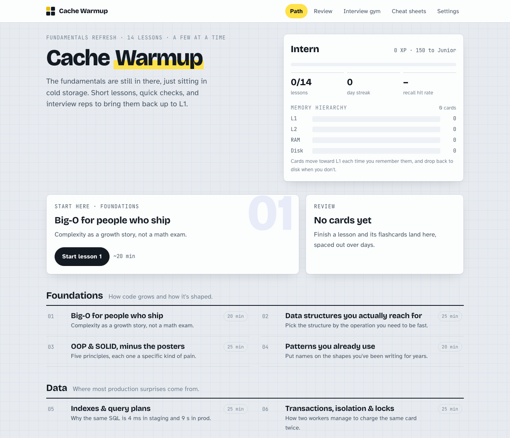

# Cache Warmup

**Your fundamentals aren't gone. They're just in cold storage.**

Cache Warmup is a set of 14 short, interactive lessons that bring software engineering fundamentals back to mind: complexity, data structures, databases, concurrency, caching, distributed systems, system design, testing, security, and how to talk about your own work in an interview.

It's for engineers who already know this stuff and haven't thought about it in a while. Maybe you're preparing for interviews, maybe your company is going through a rough patch, or maybe you just want to keep your mind sharp. It is **not** a LeetCode grind, and it isn't a wall of definitions either. Each lesson takes 20–35 minutes, so you can do a couple a week.



**Try it in your browser:** https://estebansa19.github.io/cache-warmup/ (everything except AI feedback, which needs the local server).

## What's inside

| Track           | Lessons                                                                                                                                                            |
| --------------- | ------------------------------------------------------------------------------------------------------------------------------------------------------------------ |
| **Foundations** | 1. Big-O for people who ship · 2. Data structures you actually reach for · 3. OOP & SOLID, minus the posters · 4. Patterns you already use                         |
| **Data**        | 5. Indexes & query plans · 6. Transactions, isolation & locks                                                                                                      |
| **Systems**     | 7. Concurrency, jobs & idempotency · 8. HTTP, the web & APIs · 9. Caching without regrets · 10. Distributed systems survival kit · 11. System design: the playbook |
| **Craft**       | 12. Testing that earns its keep · 13. Security essentials · 14. Telling your story (behavioral interviews)                                                         |

Every lesson opens with a real-world scenario ("two workers both charged the same card…"). Short concept cards alternate with quick checks, so you're never just reading:

- **Quick checks:** multiple choice, "myth or fact?", and "put these steps in order", each followed by an explanation.
- **An interview question:** you write the answer you'd give in the room, then compare it with a strong answer, or ask an AI interviewer for feedback (see below).
- **A cheat sheet** that you can skim the night before an interview.
- **Flashcards with spaced repetition.** Cards climb a memory hierarchy (Disk → RAM → L2 → L1) when you remember them and drop back when you don't.

There's also an **Interview gym** with every lesson's question plus 12 extra ones, plus XP and levels from Intern to Distinguished. (Yes, everyone starts as an Intern.)

Code examples lean toward Ruby on Rails and PostgreSQL, but the ideas apply to any stack.

## Run it locally

You need [Node.js](https://nodejs.org) 22 or newer.

```bash
git clone https://github.com/estebansa19/cache-warmup.git
cd cache-warmup
npm install
npm start
```

Your browser opens at **http://localhost:4317**. That's it.

## AI feedback (optional)

After you answer an interview question, an AI can play the interviewer. You get a hire/no-hire signal, what you got right, what was missing, and the follow-up question they'd probably ask next.

**There's usually nothing to configure.** `npm start` looks for an AI tool you already have and uses the first one it finds:

| Order | Tool                                                      | Uses                                     | Setup if you don't have it                                                                     |
| ----- | --------------------------------------------------------- | ---------------------------------------- | ---------------------------------------------------------------------------------------------- |
| 1     | [Claude Code](https://claude.com/claude-code)             | Your Claude plan (Pro or Max)            | Install it, run `claude` once, log in                                                          |
| 2     | [Codex CLI](https://github.com/openai/codex)              | Your ChatGPT plan                        | Install it, run `codex` once, log in                                                           |
| 3     | [Gemini CLI](https://github.com/google-gemini/gemini-cli) | Your Google account                      | Install it, run `gemini` once, log in                                                          |
| 4     | [OpenCode](https://opencode.ai)                           | Whatever provider you set up in OpenCode | Install it, run `opencode auth login`                                                          |
| 5     | [Ollama](https://ollama.com)                              | A model on your own machine (free)       | `ollama pull llama3.1` with Ollama running                                                     |
| 6     | Anthropic API                                             | API credits                              | `export ANTHROPIC_API_KEY=...`                                                                 |
| 7     | Any OpenAI-compatible API                                 | API credits                              | `export OPENAI_API_KEY=...` (plus `OPENAI_BASE_URL` for non-OpenAI servers), then pick a model |

Subscription-based tools come first on purpose: if you already pay for Claude or ChatGPT, feedback comes out of that plan instead of costing you API credits. One caveat: a CLI uses whatever account it's logged into, so if your Claude Code is logged in with an API key, feedback uses API credits.

### Choosing a tool yourself

Open **Settings** in the app. It lists every tool, marks the ones that are ready on your machine, and lets you pick one (and a model, if you want a specific one). Your choice is saved in `cache-warmup.config.json` in the project folder, so it sticks between restarts. You can also edit that file by hand:

```json
{ "provider": "opencode", "model": "" }
```

`provider` can be `auto`, `off`, or any tool id: `claude`, `codex`, `gemini`, `opencode`, `ollama`, `anthropic`, `openai`.

From the terminal:

```bash
npm run providers                        # what's available on this machine
npm start -- --provider opencode         # use this tool for this run (locks the Settings picker)
npm start -- --provider claude --model sonnet
```

### What gets sent, and what doesn't

- When you click **Get interviewer feedback**, the question, its rubric, your answer, and your optional "About you" note go to the tool you chose. Nothing is sent anywhere else, and nothing is sent until you click.
- The CLIs run in plain question-and-answer mode. Claude Code runs with every tool disabled (`--tools ""`). Each run happens in an empty temporary folder, so the AI never sees your files.
- The server only listens on your own machine (`127.0.0.1`). It rejects requests from other websites, so a page you have open elsewhere can't use your AI tool or spend your usage.
- There's no telemetry, no account, and no database. Your progress stays in your browser.

Claude Code and OpenCode have been tested end to end. Codex CLI, Gemini CLI, Ollama, and the APIs follow their documented command-line options and APIs but have had less real-world testing. If one doesn't work for you, please [open an issue](https://github.com/estebansa19/cache-warmup/issues). The server runs on macOS and Linux; on Windows, use WSL.

## Your progress

Progress is saved in your browser's local storage: XP, answers, flashcard schedule, and drafts.

- **Use the same browser** to keep your progress. Private/incognito windows forget everything when they close.
- **To move to another computer,** go to Settings → **Export progress**, then **Import progress** on the other machine. The export is also a good backup.
- **To start over,** go to Settings → **Reset**.

## Hosting it yourself

`npm run build` produces plain static files in `dist/`, which work on any static host. The [GitHub Pages workflow](.github/workflows/pages.yml) does this on every push to `main`.

AI feedback needs the local server, because that's what talks to your AI tool. To use a hosted copy _and_ AI feedback:

1. Run the server on your machine and tell it to trust your hosted address:
   ```bash
   npm run build
   CW_ALLOWED_ORIGINS=https://your-name.github.io npm run serve
   ```
2. In the hosted app, open Settings → **Advanced** and enter `http://localhost:4317`.

Your browser may ask whether the site can reach devices on your local network. Allow it.

## Add your own lessons

Lessons are Markdown files (MDX) in [`src/lessons/`](src/lessons). Quizzes are written right in the Markdown:

```mdx
<Quiz>

Which query can't use an index on `(status, account_id)` well?

- [ ] `WHERE status = 'open'`
- [x] `WHERE account_id = 9`

<Why>The index is sorted by status first.</Why>

</Quiz>
```

Drop a new file in that folder and it shows up on the path. [CONTRIBUTING.md](CONTRIBUTING.md) explains the format, how the project is organized, and how to write lessons that don't feel like a textbook.

Ideas the project would love help with: lessons on observability, Kubernetes basics, frontend performance, or AI/LLM system design; versions of the code examples in other languages; and translations.

## Troubleshooting

**"AI feedback: off" even though I have Claude Code / Codex / …**
Run `npm run providers`. The CLI needs to be on your `PATH` in the same terminal where you run `npm start`. Run the tool once by itself to make sure you're logged in, then click **Check again** in Settings.

**Feedback takes a while.**
10–30 seconds is normal. The AI is actually reading your answer. The terminal running `npm start` logs each request and how long it took.

**"Port 4317 is busy."**
Use another one: `npm start -- --port 4400`.

**The feedback came back garbled.**
Click again. Small local models (via Ollama) sometimes struggle with the expected format; a bigger model helps.

## License

[MIT](LICENSE). Use it, fork it, adapt it for your team or your bootcamp.

If Cache Warmup helped you get ready for something, a ⭐ on the repo would make my day.
